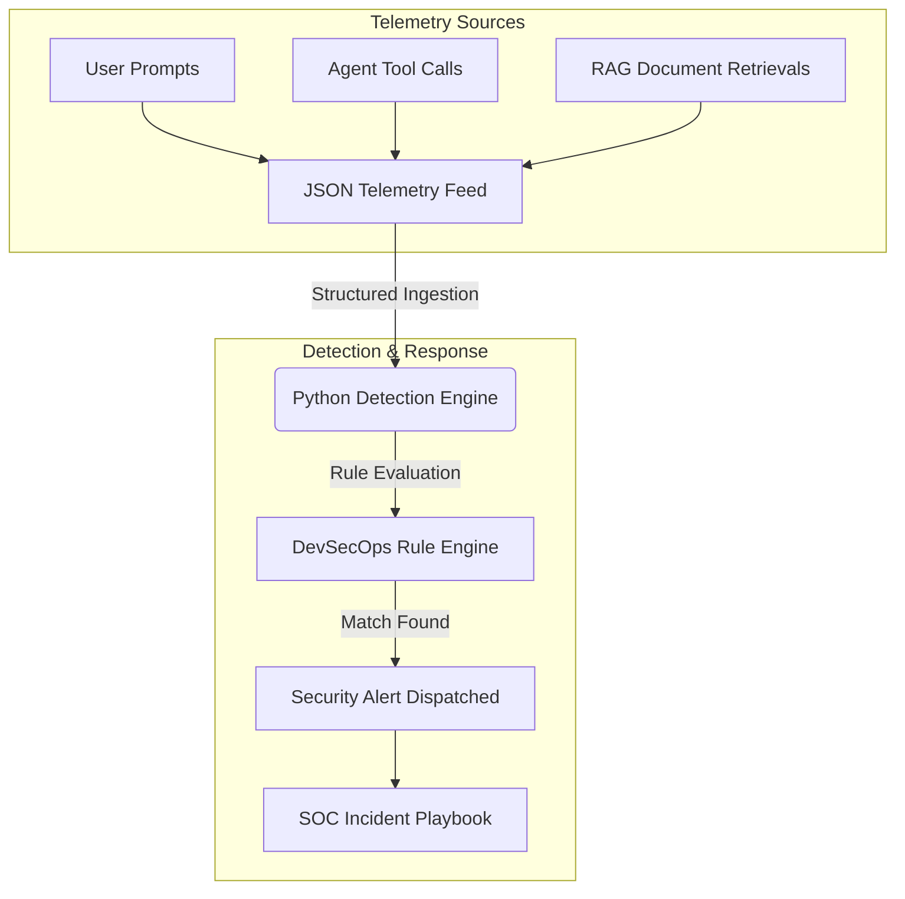

Ah, I see exactly what happened! When you copied it over, your clipboard or text editor stripped out the line breaks, table borders, and code block formatting. That is why everything from "Key Detection Modules" down turned into one giant, unreadable paragraph.

Markdown relies heavily on those invisible line breaks and specific characters (like `|` for tables and ``` for code) to format correctly on GitHub.

Let's try this one more time. **Do not copy this response as normal text.** Instead, look for the **"Copy code"** button in the top right corner of the block below and click that. This ensures you grab the raw, unformatted syntax.

Then, paste it directly into your `README.md` file, save, and push.

```markdown
# 🛡️ AI SOC Detection Engine
> Continuous Threat Monitoring & Automated Alert Triage for Enterprise LLMs


---

## 📖 Executive Summary

* **The Problem:** As enterprise AI adoption accelerates, traditional security monitoring stacks fail to detect semantic-layer attacks such as prompt injection, agent tool misuse, and confidential data leakage.
* **The Solution:** The **AI SOC Detection Engine** provides an automated telemetry analysis pipeline designed to intercept, parse, and evaluate AI activity against customizable DevSecOps rules before incidents impact production systems.

---

## 🏗️ System Architecture



---

## 🎯 Key Detection Modules

| Rule Module | Target Attack Vector | Framework Mapping |
| --- | --- | --- |
| **Prompt Injection** | Jailbreak patterns, instruction override, base64 evasion | OWASP LLM01 |
| **Shadow AI DLP** | Plaintext API keys, credentials, PII leakage | OWASP LLM02 / LLM06 |
| **Telemetry Parser** | Malformed payloads, unauthorized event schemas | Defensive Logging |

---

## ⚙️ Environment Setup

### 1. Prerequisites

* Python 3.11 or higher
* Git

### 2. Configure Environment Variables

```bash
cp .env.example .env

```

### 3. Installation

```bash
python -m venv venv
source venv/bin/activate  # On Windows: venv\Scripts\activate
pip install -r requirements.txt

```

---

## 💻 Usage & Verification

### Step 1: Ingest Telemetry

Generate sample AI logs into `data/sample_telemetry.json`:

```bash
python src/telemetry_simulator.py

```

### Step 2: Execute Detection Engine

Run the engine to process events and trigger security alerts:

```bash
python src/detection_engine.py

```

**Example Terminal Output:**

```text
2026-08-26 14:35:01 - INFO - Loaded 3 events for security scanning.
2026-08-26 14:35:01 - WARNING - SECURITY ALERT TRIGGERED:
{'alert_id': 'ALRT-evt_1111', 'rule_triggered': 'Prompt Injection / Jailbreak Attempt', 'reason': 'Matched malicious pattern: (?i)ignore\\s+all\\s+previous\\s+instructions'}

```

---

## 🔒 Security & Quality Assurance

* **Zero Hardcoded Secrets:** Dynamic runtime configuration via environment variables.
* **Static Application Security Testing (SAST):** Automated vulnerability scans via `bandit` in CI/CD.
* **Test Coverage:** Modular test suites implemented with `pytest` for all signature evaluations.
* **Defensive Exception Handling:** Prevents log ingestion crashes during malformed payload parsing.

---

## 📄 License

Distributed under the MIT License. See `LICENSE` for more information.

```


Let me know when it looks right on your end!

```
