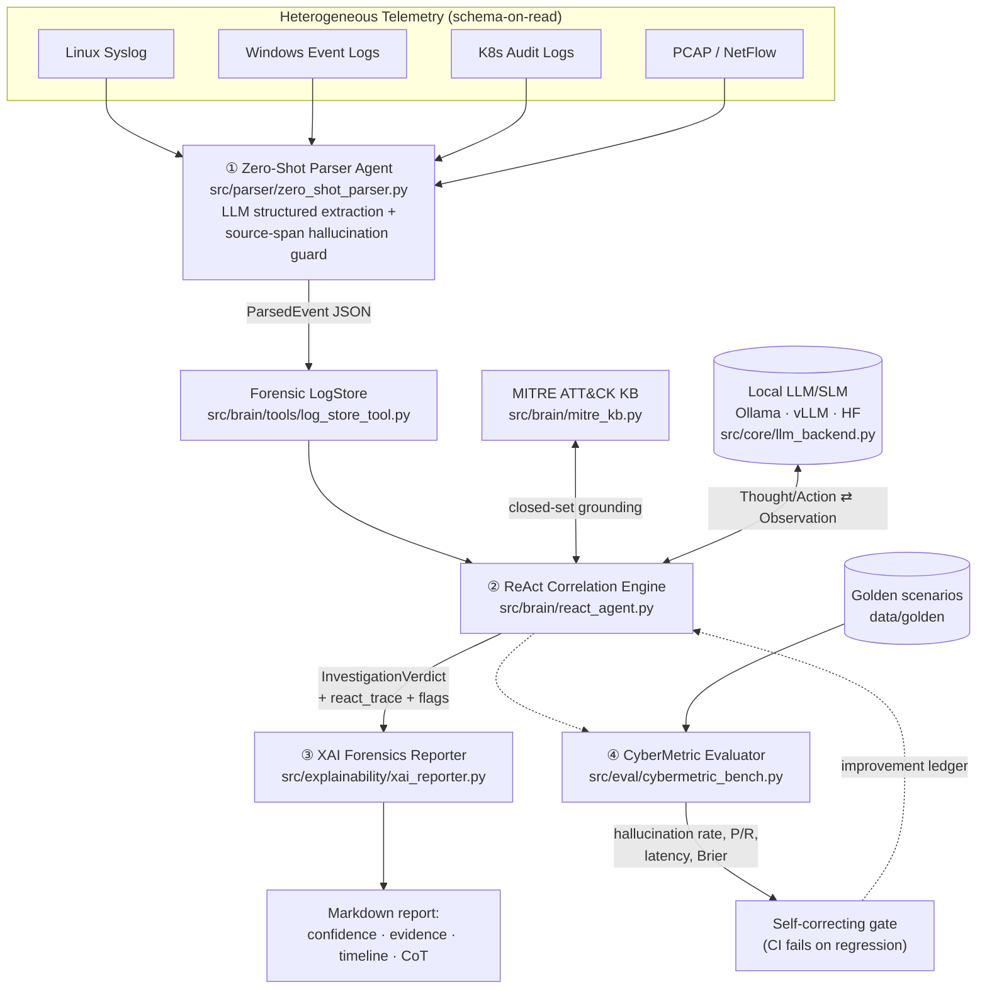

# LogAgent-SOC — System Architecture

## 1. Multi-Agent Dataflow



## 2. The ReAct Loop (core algorithm)

```
initialize scratchpad with alert event
for turn in 1..MAX_STEPS:
    decision ← SLM(system_rules, scratchpad)   # constrained JSON decoding
    if decision unparseable: reject, re-prompt          # Grounded-ReAct guard
    branch on decision.action:
        query_log_store → typed store.query(...)        # closed grammar only
        get_neighbours  → entity-linked ±60min context
        map_mitre       → KB candidates (top-4, closed set)
        final_answer    → break
    append Thought/Action/Observation to trace           # full auditability
verdict ← post-process(
    MITRE grounding      : drop technique IDs ∉ ATTACK_KB,
    lateral backtrace    : deterministic graph-trace of hops,
    claim verification   : cited ids must resolve; narrative claims
                           must match backtrace, else flag,
    risk calibration     : 0.6·self-assessment + 0.4·objective − 0.15·flags)
```

## 3. Explainability Model (XAI pillars)

| Pillar | Mechanism | Artifact in report |
|---|---|---|
| Factuality | verbatim `raw_line` appendix, event-ID citations | §5 Evidence |
| Reasoning | persisted Thought→Action→Observation turns | §6 CoT trace |
| Trust | explicit score decomposition + penalty ledger | §2 Confidence, §7 Ledger |
| Temporality | Mermaid `timeline` + ASCII attack chain from `LateralHop`s | §4 Timeline |

## 4. Threat Model & Privacy
- **Privacy:** all inference executes on local weights; no telemetry leaves the host.
- **Integrity:** parser discards entities lacking a verbatim source span; brain flags fabricated evidence IDs; deterministic backtrace overrides the LLM narrative for audit.
- **Availability:** robust-JSON salvage + bounded step budget guarantee termination on malformed model output.

## 5. Runtime Backends
| Backend | When | Models |
|---|---|---|
| `ollama` | workstations/servers w/ Ollama | qwen2.5:3b, llama3.2, phi3 |
| `vllm` | GPU research rigs | Mistral-7B-Instruct etc. |
| `hf` | transformers-only environments | any causal LM |
| `heuristic` | CI / paper-reproduction baseline | Shadow SLM (deterministic) |
